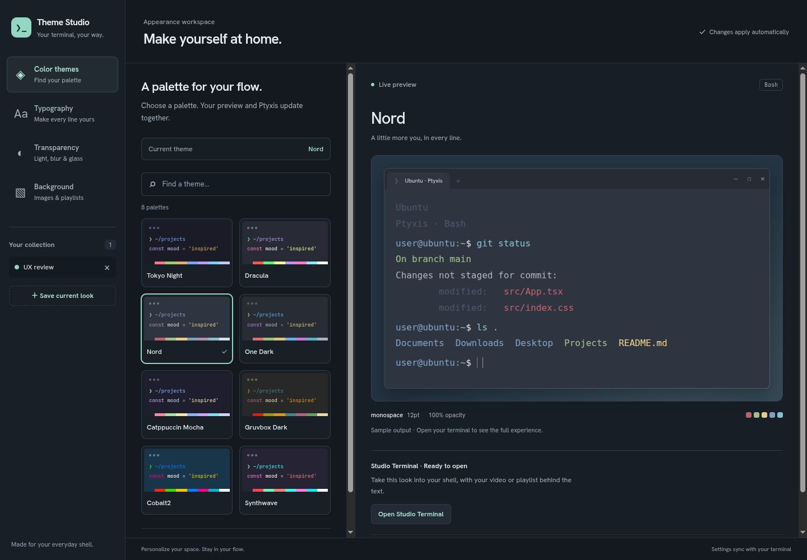
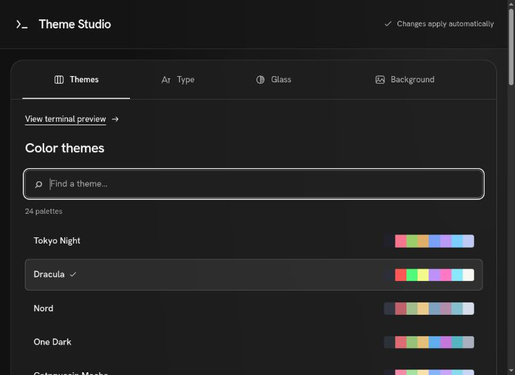
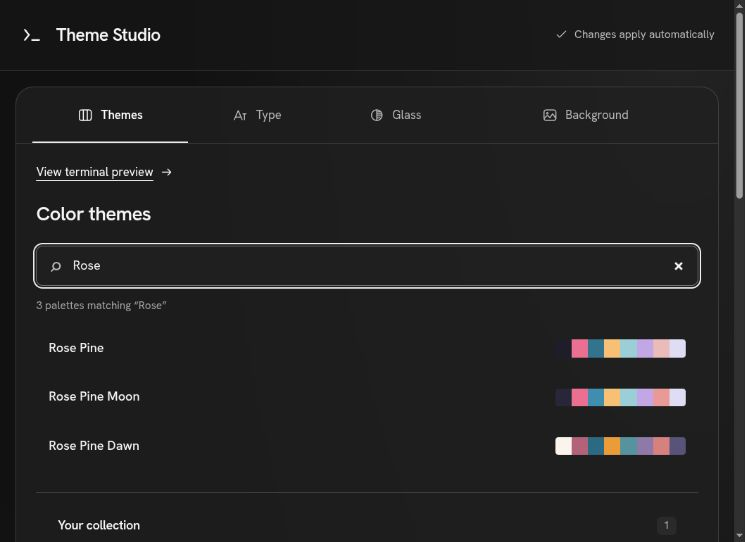

<div align="center">
  

  <h1>Terminal Theme Studio</h1>

  <p><strong>Make yourself at home in your terminal.</strong><br>
  A local control panel for terminal colors, fonts, transparency and animated backgrounds —<br>
  with a real GTK/VTE terminal on Ubuntu and Windows Terminal support on Windows 11.</p>

  <p>
    
    
    
    
    <a href=".github/workflows/windows.yml"></a>
    
  </p>

  <p>
    <a href="#install"><b>Install</b></a> ·
    <a href="#features"><b>Features</b></a> ·
    <a href="#screenshots"><b>Screenshots</b></a> ·
    <a href="#development"><b>Development</b></a> ·
    <a href="docs/ubuntu-ptyxis.md"><b>Docs</b></a>
  </p>
</div>

<p align="center">
  
</p>

> **Everything runs on `127.0.0.1`.** Your shell input never leaves the native PTY, and no theme, path or keystroke is uploaded anywhere. The web UI is a controller, not a terminal emulator in the browser.

---

## Install

Two targets, two installers. Everything else is shared: the same web UI, the same palettes, the same playlists.

| | **Windows 11** | **Ubuntu (GNOME)** |
| --- | --- | --- |
| Terminal it themes | Windows Terminal (`wt.exe`) | **Studio Terminal** — GTK3 + VTE with a real shell |
| Entry point | `start-windows.cmd` | `bun run install:ubuntu` |
| Opens | Control panel in your browser | Native window + control panel |
| Backgrounds | Images, GIFs, prepared video → GIF | Images, GIFs, **native GStreamer video** |
| Blur | Windows Acrylic | Blur my Shell extension |
| Requirements | Bun · Git · Rust · FFmpeg (video) | Bun · Rust · Python 3 · GTK3/VTE/GStreamer |

<details open>
<summary><b>🪟 Windows 11 quick start</b></summary>

<br>

Install the prerequisites with `winget`:

```powershell
winget install --id Oven-sh.Bun -e
winget install --id Git.Git -e
winget install --id Microsoft.WindowsTerminal -e
winget install --id Gyan.FFmpeg.Essentials -e
winget install --id Rustlang.Rustup -e
```

Reopen PowerShell, then clone and launch:

```powershell
git clone https://github.com/MCTEEKUNG/terminal-theme-studio.git
cd terminal-theme-studio
bun install
.\start-windows.cmd
```

The launcher builds the UI and the Rust media worker on first use, starts a hidden local controller, and opens **http://127.0.0.1:5555/**. Open Windows Terminal once and save its settings before the first run — Stable, Preview and unpackaged locations are detected automatically, in that order.

Optional Start menu shortcut (current user, no administrator required):

```powershell
bun run install:windows
bun run install:windows -- -AutoStart   # also start at sign-in
.\start-windows.cmd -Stop               # stop the controller
```

See **[Windows 11 setup and troubleshooting](docs/windows-11.md)** for custom settings paths, portable installs, backups and uninstall steps.

</details>

<details open>
<summary><b>🐧 Ubuntu quick start</b></summary>

<br>

Run as your normal desktop user in a GNOME session.

```bash
sudo apt install build-essential git ffmpeg python3-gi python3-gi-cairo \
  gir1.2-gtk-3.0 gir1.2-vte-2.91 gir1.2-gstreamer-1.0 \
  gstreamer1.0-plugins-base gstreamer1.0-plugins-good \
  gstreamer1.0-libav desktop-file-utils xdg-terminal-exec

git clone https://github.com/MCTEEKUNG/terminal-theme-studio.git
cd terminal-theme-studio
bun install
```

Install the launcher and background controller, and make Studio Terminal your default terminal:

```bash
bun run install:ubuntu
```

This installs a per-user application named **Terminal**, enables the systemd user service, and serves the control panel at **http://localhost:5555/**. Existing Ptyxis remains available as **Terminal (Ptyxis)**. Keep the checkout in place; reinstall if you move it.

Prefer to keep your current default terminal?

```bash
python3 native/install.py          # install without changing the default
python3 native/install.py --restore-default
```

True desktop blur requires the **[Blur my Shell](docs/ubuntu-ptyxis.md)** GNOME extension and its application-blur configuration — the blur softens the desktop behind the window while video and text stay sharp.

</details>

---

## Features

| | |
| --- | --- |
| 🎨 **Live appearance controls** | Colors, fonts, opacity, background placement, tab styling, spacing and hover effects — preview and terminal update together. |
| 🖌️ **24 color palettes** | Editable ANSI colors, light/dark pairs, saved looks and portable **Collections**. |
| 🎞️ **Image, GIF and video backgrounds** | Native video playback on Ubuntu; prepared GIFs on Windows. Frame rate and width are adjustable per video. |
| 📂 **Playlists** | Recursive folder import, duplicate skipping, manual ordering, shuffle, repeat-one and loop-all. |
| ⏱️ **Playback timing** | Play each clip to completion, or advance after a set duration. Images and GIFs keep their own durations. |
| 🗂️ **Tabs and windows** | Rename from the context menu, drag to reorder, middle-click to close — with confirmation before closing a busy session. |
| 🔗 **Desktop integration** | Ubuntu launcher, automatic controller startup, optional default-terminal selection. |
| 🧩 **Ptyxis + Windows Terminal** | Writes through the official settings files/bridges: Ptyxis for GNOME, JSONC-preserving `settings.json` edits on Windows. |
| 🔒 **Local by design** | Binds to `127.0.0.1`. No accounts, no telemetry, no shell traffic over the wire. |

<details>
<summary><b>How the Windows settings writer behaves</b></summary>

<br>

JSON comments, trailing commas and a BOM survive the round-trip. The original file is backed up to `settings.json.theme-studio.bak` before the first edit, and unrelated profiles, shortcuts and settings are preserved. Missing `profiles.defaults` and `schemes` are created as needed.

Changes target `profiles.defaults`. If a profile defines its own `colorScheme`, `font`, `opacity` or `backgroundImage`, that override wins — reset it in Windows Terminal's *Appearance* page to inherit the Studio settings.

</details>

---

## Screenshots

<table>
  <tr>
    <td width="50%"><br><sub><b>Palette browser</b> — filter, preview, apply.</sub></td>
    <td width="50%"><br><sub><b>Search</b> — jump to any of the 24 palettes.</sub></td>
  </tr>
  <tr>
    <td width="50%"><br><sub><b>Compact layout</b> — themes, type, glass, background.</sub></td>
    <td width="50%"><br><sub><b>Desktop layout</b> — three panes, live preview, launcher.</sub></td>
  </tr>
</table>

---

## Using Studio Terminal (Ubuntu)

Open **Terminal** from the application menu, run `~/.local/bin/studio-terminal`, or use the gear button in the window to open the control panel. Appearance changes apply to existing windows without restarting your shell; Python behavior changes take effect the next time the app starts.

```bash
~/.local/bin/studio-terminal
~/.local/bin/studio-terminal --new-window
~/.local/bin/studio-terminal --working-directory ~/Documents
~/.local/bin/studio-terminal --hold -- bash -c 'echo hello'
```

| Action | Shortcut |
| --- | --- |
| New tab | <kbd>Ctrl</kbd>+<kbd>Shift</kbd>+<kbd>T</kbd> |
| Close tab | <kbd>Ctrl</kbd>+<kbd>Shift</kbd>+<kbd>W</kbd> or middle-click the tab |
| Switch tabs | <kbd>Ctrl</kbd>+<kbd>PageUp</kbd> / <kbd>PageDown</kbd>, or <kbd>Alt</kbd>+<kbd>1</kbd>…<kbd>9</kbd> |
| Copy / paste | <kbd>Ctrl</kbd>+<kbd>Shift</kbd>+<kbd>C</kbd> / <kbd>V</kbd> |
| Fullscreen | <kbd>F11</kbd> |
| Rename tab | Right-click the tab → **Rename Tab…** |

In **Background → Playlist → Switch to next clip**, choose **Play full video — then next clip** for automatic timing, or **After a set duration** to enter durations yourself. Pausing the playlist stops advancement; the displayed background keeps looping.

---

## How it works

```
server.ts                 Bun backend — settings bridge, playlist engine, GIF queue, WebSocket
src/                      React + Vite control panel (this is what the browser loads)
lib/                      Server-side bridges — Ptyxis, GNOME glass, appearance, media worker
native/terminal.py        Studio Terminal: GTK3 + VTE window, GStreamer backgrounds
native/gif-worker/        Dependency-free Rust worker orchestrating FFmpeg (two bounded-memory passes)
scripts/                  Windows launcher / installer, cross-platform worker build
tests/                    Bun + React tests; native integration tests under native/
```

The controller binds to `127.0.0.1`. Shell input stays inside the native PTY; the web UI only controls appearance and playlists. Prepared GIF variants are validated by source identity, modification time, FPS and width, then reused instead of re-encoded.

---

## Development

```bash
bun install
bun run dev
```

Vite serves the UI at **http://localhost:5555/** and proxies `/api` and `/ws` to the Bun backend on **port 3001**. Stop an installed controller first to free the port:

```bash
systemctl --user stop terminal-theme-studio    # Ubuntu
.\start-windows.cmd -Stop                      # Windows
```

Resume normal use afterwards with `systemctl --user start terminal-theme-studio`.

Serve a production build without installing desktop integration:

```bash
bun run build
PORT=5555 bun run server
```

### Checks

```bash
bun run test        # builds the Rust worker, then runs the suite
bun run typecheck
bun run build
```

Native integration tests also need `xvfb` and `dbus-run-session`:

```bash
sudo apt install xvfb dbus-daemon
xvfb-run -a python3 -m unittest native/test_terminal.py native/test_cli.py
```

`bun run dev`, `bun run test` and `bun run build` build the Rust media worker when needed; to run `bun test` directly, run `bun run build:worker` first. FFmpeg and FFprobe must be on `PATH` for media tests.

---

## Configuration and troubleshooting

Local settings and generated data are excluded from Git:

| Path | Purpose |
| --- | --- |
| `wt-settings.json` | Saved settings on Linux / development fallback |
| `playlist.json` | Local media paths, ordering and playback state |
| `themes.json` | Saved looks |
| `.playlist-cache/` | Converted media |
| `.native-runtime/` | Native status and logs |
| `.desktop-integration-backup/`, `.ptyxis-backup/` | Original desktop and Ptyxis preferences |

<details>
<summary><b>Windows: choosing a settings file</b></summary>

<br>

The backend detects Stable, Preview and unpackaged Windows Terminal settings. Use a specific file (including portable installs):

```powershell
.\start-windows.cmd -SettingsPath 'D:\Terminal portable\settings\settings.json'
$env:WT_EXECUTABLE = 'D:\Terminal portable\wt.exe'
```

Or set `WT_SETTINGS_PATH` (and `WT_EXECUTABLE`) in your user environment so the Start menu shortcut picks it up. The native GTK/VTE terminal and the Ubuntu installer are Linux features; Ptyxis itself does not support video backgrounds.

</details>

<details>
<summary><b>Ubuntu: inspecting the controller</b></summary>

<br>

```bash
systemctl --user status terminal-theme-studio
journalctl --user -u terminal-theme-studio
```

Native window stuck or logging out? Check `.native-runtime/` for status and logs.

</details>

---

## Documentation

| Document | Contents |
| --- | --- |
| [Windows 11](docs/windows-11.md) | Installation, settings selection, acrylic, FFmpeg, collections, uninstall |
| [Ubuntu / Studio Terminal and Ptyxis](docs/ubuntu-ptyxis.md) | Desktop integration, blur, shortcuts, backups, limitations |
| [Design notes](DESIGN.md) | Visual system behind the control panel |
| [Product notes](PRODUCT.md) | Scope and intent |

Palette attribution: [iTerm2 color schemes license](public/licenses/iterm2-color-schemes.txt).

<div align="center">
  <sub>Built for people who spend too much time looking at their terminal — and want it to look good.</sub>
</div>
