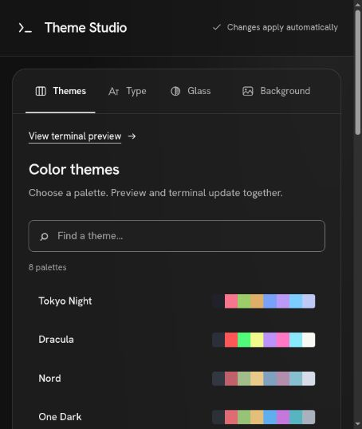

# Terminal Theme Studio

A local web control panel for terminal themes, fonts, transparency, and animated backgrounds. On Ubuntu, Studio Terminal provides a native GTK/VTE terminal with real shell sessions and live appearance updates.



## Features

- **Live appearance controls:** change colors, fonts, opacity, background placement, tab styling, spacing, and hover effects from the web UI.
- **24 color palettes**, editable ANSI colors, and saved looks.
- **Image, GIF, and video backgrounds.** Native video playback uses the original video, with adjustable frame rate.
- **Playlists:** recursive folder import, duplicate skipping, manual ordering, shuffle, repeat one, and loop all.
- **Playback timing:** choose a set duration or play each video to completion before advancing. Manual duration controls appear only in the timed mode; images and GIFs retain their individual durations.
- **Multiple terminal tabs and windows:** rename tabs from the context menu, drag to reorder, and middle-click to close.
- **Busy-session protection:** confirmation before closing a tab or window with running jobs.
- **Ubuntu desktop integration:** application launcher, automatic controller startup, and optional default-terminal selection.
- **Ptyxis integration** for colors, fonts, and opacity, plus Windows Terminal settings support.

## Ubuntu quick start

Run the application as your normal desktop user in a GNOME session. You need [Bun](https://bun.sh), Python 3, and these native dependencies:

```bash
sudo apt install git ffmpeg python3-gi python3-gi-cairo \
  gir1.2-gtk-3.0 gir1.2-vte-2.91 gir1.2-gstreamer-1.0 \
  gstreamer1.0-plugins-base gstreamer1.0-plugins-good \
  gstreamer1.0-libav desktop-file-utils xdg-terminal-exec

git clone https://github.com/MCTEEKUNG/terminal-theme-studio.git
cd terminal-theme-studio
bun install
```

Install the launcher and background controller, and make Studio Terminal your default terminal:

```bash
bun run install:ubuntu
```

This installs a per-user application named **Terminal**, enables the systemd user service, and serves the control panel at **http://localhost:5555/**. Existing Ptyxis remains available as **Terminal (Ptyxis)**. Keep the checkout in place; reinstall if you move it.

To install without changing your default terminal, use this instead:

```bash
python3 native/install.py
```

True desktop blur requires the **Blur my Shell** GNOME extension and its application-blur configuration. The blur softens the desktop behind the window while video and terminal text stay sharp. See the [Ubuntu integration guide](docs/ubuntu-ptyxis.md) for setup, limitations, and restoring previous defaults.

## Using Studio Terminal

Open **Terminal** from the application menu, or run:

```bash
~/.local/bin/studio-terminal
~/.local/bin/studio-terminal --new-window
~/.local/bin/studio-terminal --working-directory ~/Documents
~/.local/bin/studio-terminal --hold -- bash -c 'echo hello'
```

Use the gear button to open the web control panel. Appearance changes apply to existing windows without restarting shell sessions. Updates to the terminal's Python behavior take effect when the application starts again.

| Action | Shortcut |
| --- | --- |
| New tab | Ctrl+Shift+T |
| Close tab | Ctrl+Shift+W or middle-click the tab |
| Switch tabs | Ctrl+PageUp / Ctrl+PageDown or Alt+1…9 |
| Copy / paste | Ctrl+Shift+C / Ctrl+Shift+V |
| Fullscreen | F11 |
| Rename tab | Right-click the tab → Rename Tab… |

In **Background → Playlist → Switch to next clip**, choose **Play full video — then next clip** for automatic video timing, or **After a set duration** to enter durations yourself. Pausing the playlist stops advancement; the displayed background continues looping.

## Development

```bash
bun install
bun run dev
```

Vite serves the UI at **http://localhost:5555/** and proxies API/WebSocket requests to the Bun backend on port **3001**. If the installed controller is running, stop it first to free port 5555:

```bash
systemctl --user stop terminal-theme-studio
```

After stopping the development servers, resume normal use with:

```bash
systemctl --user start terminal-theme-studio
```

To serve a production build directly without installing desktop integration:

```bash
bun run build
PORT=5555 bun run server
```

### Checks

```bash
bun test
bun run build
./node_modules/.bin/tsc --noEmit
```

Native integration tests also require `xvfb` and `dbus-run-session`:

```bash
sudo apt install xvfb dbus-daemon
xvfb-run -a python3 -m unittest native/test_terminal.py native/test_cli.py
```

## Configuration and troubleshooting

The controller binds to `127.0.0.1`. Shell input stays inside the native PTY; the web UI controls appearance and playlists.

Local settings and generated data are excluded from Git:

| Path | Purpose |
| --- | --- |
| `wt-settings.json` | Saved settings on Linux / development fallback |
| `playlist.json` | Local media paths, ordering, and playback state |
| `themes.json` | Saved looks |
| `.playlist-cache/` | Converted media |
| `.native-runtime/` | Native status and logs |
| `.desktop-integration-backup/`, `.ptyxis-backup/` | Original desktop and Ptyxis preferences |

On Windows, the backend uses Windows Terminal's standard settings location when `LOCALAPPDATA` is available. Set `WT_SETTINGS_PATH` to use a specific settings file. The native GTK/VTE terminal and Ubuntu installer are Linux features; Ptyxis itself does not support video backgrounds.

Inspect the installed controller:

```bash
systemctl --user status terminal-theme-studio
journalctl --user -u terminal-theme-studio
```

Restore the original Ubuntu default-terminal preference:

```bash
python3 native/install.py --restore-default
```

For glass settings, performance controls, backups, and detailed installation behavior, read [Ubuntu / Studio Terminal and Ptyxis](docs/ubuntu-ptyxis.md).

Additional palette attribution is included in [the iTerm2 color schemes license](public/licenses/iterm2-color-schemes.txt).
